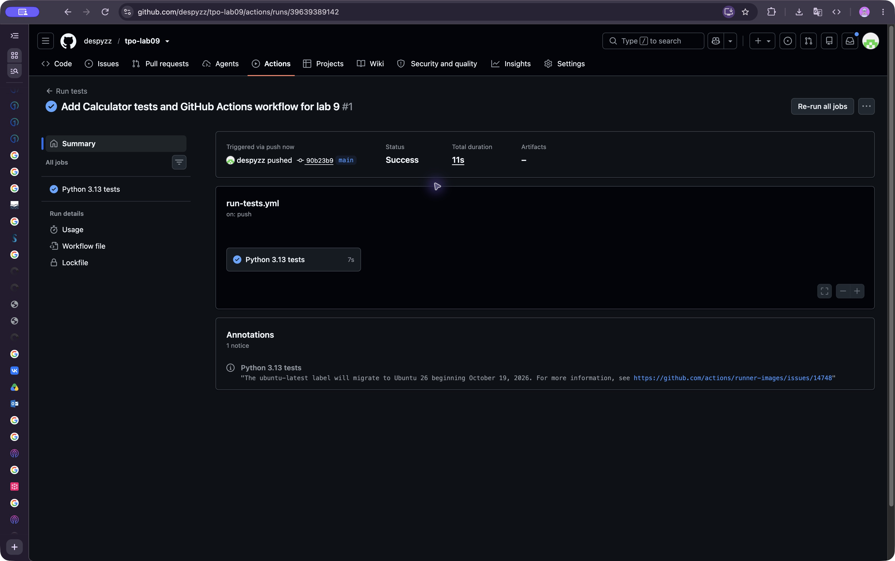
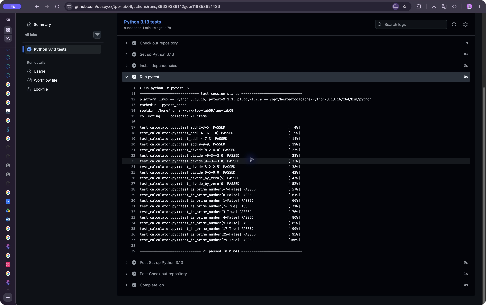

# Отчёт по лабораторной работе 9

**Тема:** запуск автотестов в CI/CD через GitHub Actions.  
**Объект:** класс `Calculator` и 21 модульная проверка из лабораторной работы № 6.  
**Дата локальной проверки:** 21 октября 2026 года.  
**Окружение локальной проверки:** Python 3.13.5, pytest 9.1.1, macOS.  
**Репозиторий:** [despyzz/tpo-lab09](https://github.com/despyzz/tpo-lab09)

## Цель и исходные материалы

Цель — автоматически запускать автотесты при отправке изменений в публичный репозиторий GitHub. Согласно заданию используются тесты из предыдущей работы; новое приложение не разрабатывалось.

Из лабораторной работы № 6 без изменений перенесены `calculator.py`, `test_calculator.py` и `requirements.txt`. Побайтовое сравнение подтвердило совпадение всех трёх файлов. Класс предоставляет методы `add`, `divide`, `is_prime_number`. Проверки изолированы, каждый тест создаёт новый объект. Параметризация задаёт входные данные и ожидаемые результаты; исключение при делении на ноль проверяется через `pytest.raises`.

## Подготовка и локальная проверка

В отдельном каталоге работы создано новое виртуальное окружение. Зависимости установлены из PyPI.

```bash
python3.13 -m venv .venv
source .venv/bin/activate
python -m pip install --no-cache-dir -r requirements.txt
python -m pytest -v
```

Все команды выполняются из корня репозитория. В Windows активация: `.venv\Scripts\activate`.

| Группа | Сценарии | Проверок | Результат |
| --- | --- | ---: | --- |
| Сложение | Положительные, отрицательные числа, разные знаки, ноль | 4 | Пройдены |
| Деление | Целый и дробный результат, разные знаки, нулевое делимое | 5 | Пройдены |
| Деление на ноль | Ненулевое и нулевое делимое, ожидание ZeroDivisionError | 2 | Пройдены |
| Простота числа | Отрицательное число, 0, 1, простые и составные числа | 10 | Пройдены |
| **Всего** | | **21** | **Пройдены** |

Фактический локальный результат: **21 passed in 0.02s**, код завершения **0**. Полный вывод: [local-pytest.txt](results/local-pytest.txt). Версии, время проверки и код завершения: [local-run.json](results/local-run.json). [install.txt](results/install.txt) содержит повторную проверку зависимостей после их установки в новое окружение.

## Настройка GitHub Actions

Конфигурация расположена в `.github/workflows/run-tests.yml` относительно корня репозитория. Она задаёт следующие события:

- каждый `push` в любую ветку;
- открытие, обновление и повторное открытие pull request в `main`;
- ручной запуск `workflow_dispatch`.

Одна задача `Python 3.13 tests` выполняется на `ubuntu-latest` с ограничением времени 10 минут. Шаги: получение кода, установка Python 3.13, установка зависимостей и запуск `python -m pytest -v`. Разрешения токена ограничены `contents: read`. Код завершения pytest передаётся GitHub Actions без подавления ошибки; падение проверки делает задачу неуспешной.

Использованы [actions/checkout@v7](https://github.com/actions/checkout) и [actions/setup-python@v7](https://github.com/actions/setup-python). Подход описан в [официальном руководстве GitHub по Python](https://docs.github.com/en/actions/tutorials/build-and-test-code/python).

## Результат проверки на GitHub

Создан публичный репозиторий [despyzz/tpo-lab09](https://github.com/despyzz/tpo-lab09), основная ветка — `main`. Отправка исходного коммита автоматически вызвала событие `push` и запуск workflow.

| Показатель | Фактический результат |
| --- | --- |
| Запуск | [Run tests № 1](https://github.com/despyzz/tpo-lab09/actions/runs/39639389142) |
| Проверенный коммит | [`90b23b9aa9cc998e408ac056057984ad95f951ce`](https://github.com/despyzz/tpo-lab09/commit/90b23b9aa9cc998e408ac056057984ad95f951ce) |
| Событие / ветка | `push` / `main` |
| Среда | GitHub-hosted runner, `ubuntu-latest`, Linux |
| Python / pytest | 3.13.16 / 9.1.1 |
| Тесты | **21 passed in 0.04s** |
| Статус workflow | **Success** |
| Длительность workflow / задачи | 11 с / 7 с |

Статус проверен на странице запуска, все 21 результата — в развёрнутом шаге [Run pytest](https://github.com/despyzz/tpo-lab09/actions/runs/39639389142/job/119358621436). [github-pytest.txt](results/github-pytest.txt) содержит текст вывода pytest, извлечённый из журнала в браузере; [github-run.json](results/github-run.json) фиксирует проверенные параметры запуска. Скриншоты относятся к указанному исходному коммиту; последующее обновление добавляет отчёт и подтверждающие материалы без изменения приложения, тестов, зависимостей или workflow.





## Вывод

Настроен автоматический запуск существующих модульных тестов через GitHub Actions. Публичный репозиторий создан, отправка коммита запустила workflow, все 21 проверка прошли локально и на GitHub. Автоматический запуск по `push` проверен фактически; запуск по pull request и ручной запуск настроены в конфигурации и отдельно не выполнялись.

## Повторный запуск

Отправить коммит в репозиторий и открыть вкладку **Actions → Run tests**. Для ручного запуска выбрать **Run workflow**, ветку `main` и подтвердить запуск. В задаче открыть шаг **Run pytest**: ожидается `21 passed`, итоговый статус задачи — `Success`.

Установка зависимостей требует доступа к PyPI. Сами тесты не используют сеть, браузер, базу данных или внешние службы. В этой работе реализуется непрерывная интеграция; развёртывание приложения заданием не требуется.

## Приложение: полный код

### `calculator.py`

```python
"""Небольшой класс с арифметической логикой для модульного тестирования."""

from math import isqrt


class Calculator:
    """Складывает, делит и проверяет простоту целого числа."""

    def add(self, first: int, second: int) -> int:
        """Вернуть сумму двух чисел."""
        return first + second

    def divide(self, dividend: int, divisor: int) -> float:
        """Вернуть частное; при нулевом делителе Python вызовет ZeroDivisionError."""
        return dividend / divisor

    def is_prime_number(self, number: int) -> bool:
        """Вернуть True, если целое число больше 1 и не имеет делителей."""
        if number < 2:
            return False
        for divisor in range(2, isqrt(number) + 1):
            if number % divisor == 0:
                return False
        return True
```

### `test_calculator.py`

```python
"""Изолированные параметризованные проверки всех методов Calculator."""

import pytest

from calculator import Calculator


@pytest.mark.parametrize(
    "first,second,expected",
    [
        (2, 3, 5),
        (-4, -6, -10),
        (-4, 7, 3),
        (0, 9, 9),
    ],
)
def test_add(first, second, expected):
    assert Calculator().add(first, second) == expected


@pytest.mark.parametrize(
    "dividend,divisor,expected",
    [
        (8, 2, 4.0),
        (-9, 3, -3.0),
        (9, -3, -3.0),
        (5, 2, 2.5),
        (0, 5, 0.0),
    ],
)
def test_divide(dividend, divisor, expected):
    assert Calculator().divide(dividend, divisor) == expected


@pytest.mark.parametrize("dividend", [5, 0])
def test_divide_by_zero(dividend):
    with pytest.raises(ZeroDivisionError):
        Calculator().divide(dividend, 0)


@pytest.mark.parametrize(
    "number,expected",
    [
        (-7, False),
        (0, False),
        (1, False),
        (2, True),
        (3, True),
        (4, False),
        (9, False),
        (17, True),
        (25, False),
        (29, True),
    ],
)
def test_is_prime_number(number, expected):
    assert Calculator().is_prime_number(number) is expected
```

### `requirements.txt`

```text
pytest==9.1.1
```

### `.github/workflows/run-tests.yml`

```yaml
name: Run tests

on:
  push:
  pull_request:
    branches: [main]
  workflow_dispatch:

permissions:
  contents: read

jobs:
  test:
    name: Python 3.13 tests
    runs-on: ubuntu-latest
    timeout-minutes: 10
    steps:
      - name: Check out repository
        uses: actions/checkout@v7
      - name: Set up Python 3.13
        uses: actions/setup-python@v7
        with:
          python-version: '3.13'
      - name: Install dependencies
        run: python -m pip install -r requirements.txt
      - name: Run pytest
        run: python -m pytest -v
```
